# MODY

> 친구와 함께 만드는 다이어트 습관

MODY는 혼자 지속하기 어려운 다이어트를 친구와 함께 기록하고 공유하는 소셜 다이어트 서비스입니다. 그룹에 참여해 식사와 운동을 사진으로 기록하고, 그룹 피드와 주간 활동을 통해 서로의 습관을 확인할 수 있습니다.

그룹과 기록 경험을 중심으로 챌린지, 건강 데이터 연동, 소셜 기능을 함께 제공합니다.

## Release

- [App Store에서 MODY 다운로드](https://apps.apple.com/kr/app/id6785124295)
- **개발 참여 범위: 프로젝트 최초 시작부터 1.2.0 버전 개발까지**
- **운영 배포 범위: 1.1.6 버전까지**

## App Images

|**`로그인`**|**`식사·운동 일정`**|**`그룹 생성`**|**`그룹 참여`**|
|:-------------:|:-------------:|:-------------:|:-------------:|
|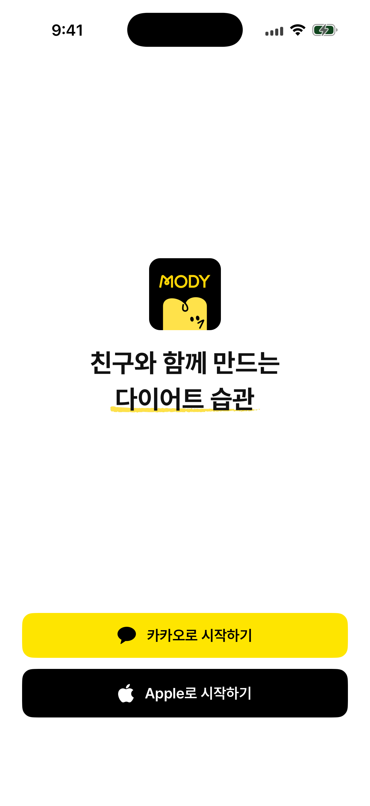|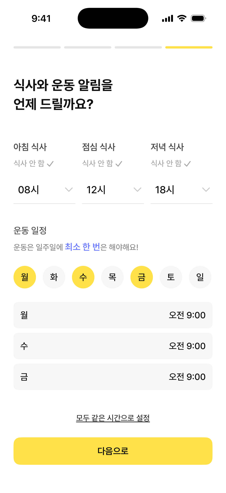|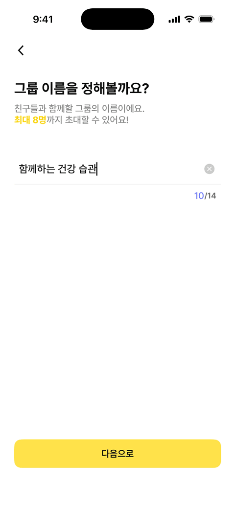|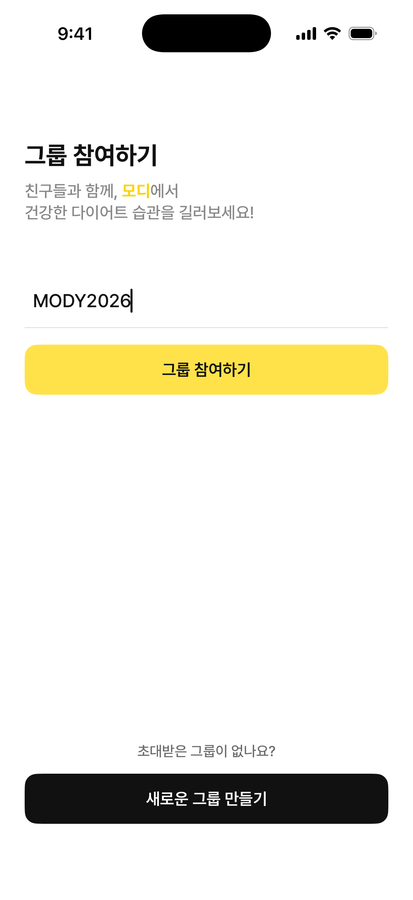|
|**`그룹 피드`**|**`사진 ROI`**|**`운동 기록`**|**`연속 기록`**|
|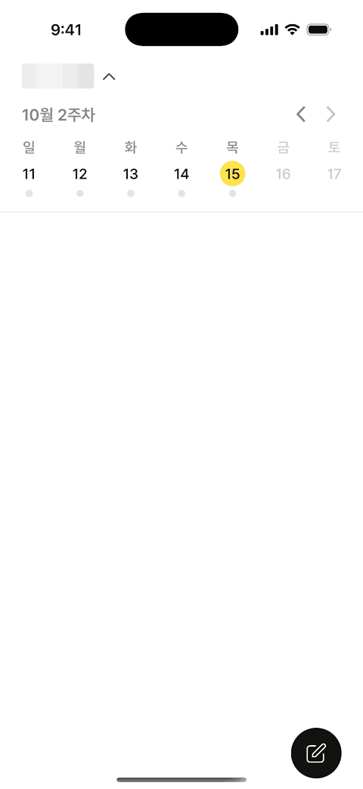|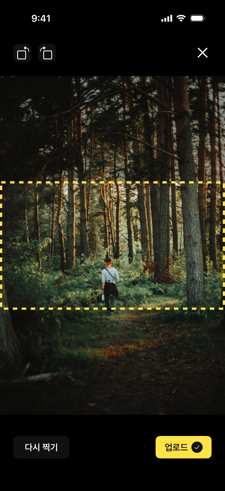|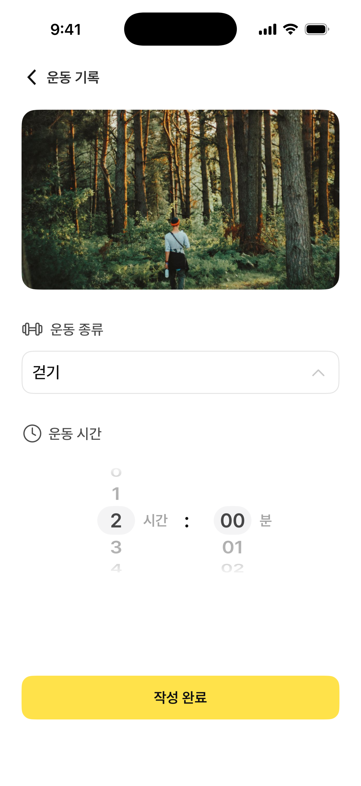|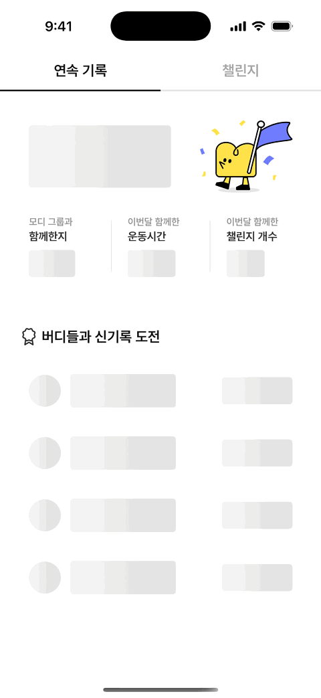|
|**`체중 기록`**|**`그룹 챌린지`**|**`주간 챌린지`**|**`마이페이지`**|
|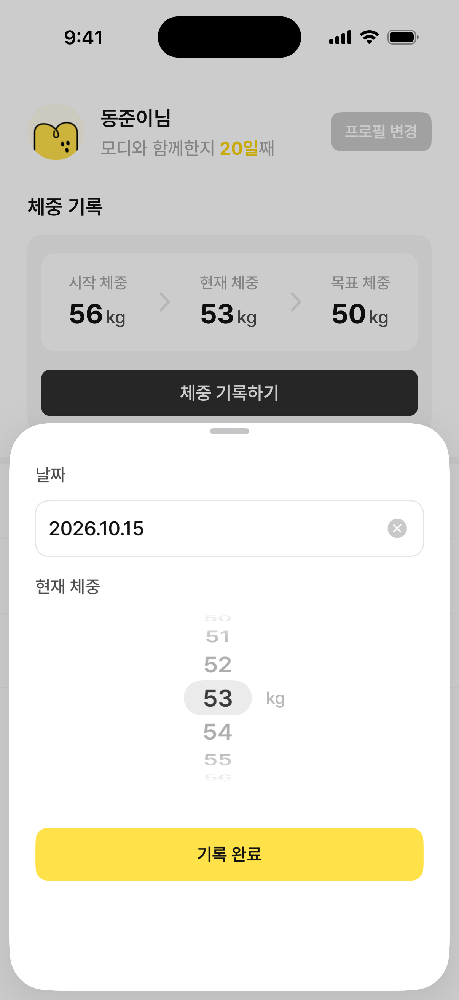|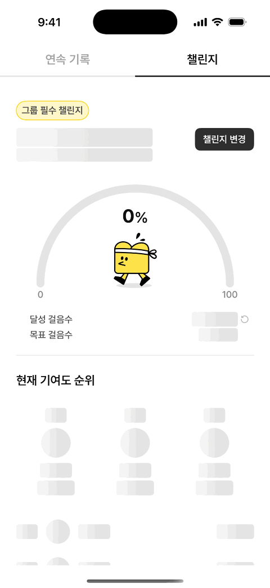|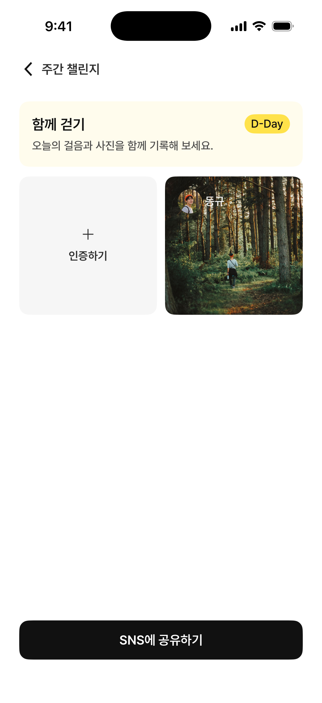|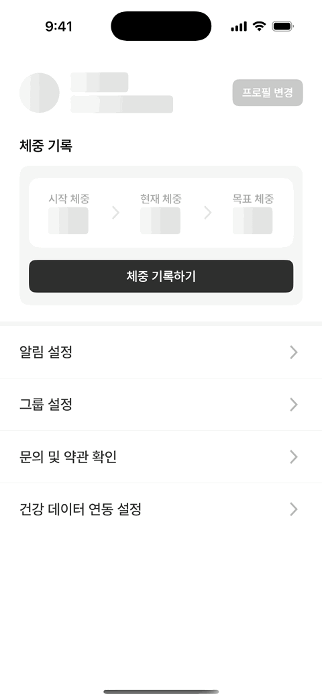|

## Tech Stack

| Category | Stack |
| --- | --- |
| Language | Swift |
| UI | UIKit, SwiftUI |
| Architecture | Micro Feature Architecture, Clean Architecture |
| State Management | TCA, ReactorKit |
| Reactive | RxSwift, RxCocoa, RxRelay |
| Networking | Alamofire |
| Dependency Injection | Swinject |
| Layout | SnapKit |
| Image | Nuke |
| Service | Firebase, Kakao SDK |
| Project Generation | Tuist |
| Test | XCTest |
| CI/CD | GitHub Actions, Fastlane |

## Features

- Kakao·Apple 로그인 및 온보딩
- 그룹 생성·참여·초대·관리
- 식사·운동 사진 기록
- 그룹 피드 및 주간 활동 확인
- 프로필 및 체중 관리
- 식사·운동 리마인더와 기본 알림
- 그룹 챌린지
- 건강 데이터 연동
- 댓글 및 콕 찌르기
- 챌린지·댓글 관련 알림
- 기록 상세 및 소셜 상호작용 확장

## Architecture

MODY는 Toss의 **Micro Feature Architecture**를 참고해 기능별 모듈을 구성했습니다. 각 기능의 구현과 외부 계약을 분리하고, 모듈 내부에서도 Presentation, Domain, Data의 책임과 의존성 경계를 명확히 하는 데 중점을 두었습니다.

### Project Structure

```text
Projects
├── App           # 앱 진입점, Composition Root, DI
├── Feature       # 사용자 기능 단위 Micro Feature
├── Core          # Network, Auth, Camera, Notification, Image 등 기반 기능
├── Domain        # 여러 모듈이 공유하는 도메인 모델과 정책
├── DesignSystem  # 공통 UI 컴포넌트, 디자인 토큰, 리소스
└── Shared        # Logger, Utility 등 공통 도구
```

### Micro Feature Targets

기능 모듈은 필요에 따라 아래와 같은 독립 타깃으로 분리됩니다.

| Target | Responsibility |
| --- | --- |
| `Feature` | 기능의 실제 구현 |
| `Interface` | 외부에 공개할 입력·출력, Route |
| `Testing` | Demo와 Tests에서 재사용하는 Fixture·Stub 등 검증 지원 코드 |
| `Tests` | 실제 모듈 구현의 상태 변화, 비즈니스 규칙, 데이터 처리를 검증하는 단위 테스트 |
| `Demo` | 기능을 독립적으로 실행하고 확인하는 데모 앱 |

### Feature Layers

```text
Feature
└── Sources
    ├── Presentation  # 화면, 사용자 이벤트, 상태 표현
    ├── Domain        # 비즈니스 규칙, UseCase, Repository 계약
    ├── Data          # API, DTO, Repository 구현
    └── Builder       # 기능 생성과 의존성 조립
```

### UIKit·ReactorKit과 SwiftUI·TCA의 병행

실제 서비스에서 UIKit과 SwiftUI를 혼합해 사용하는 상황을 가정해, **UIKit·ReactorKit과 SwiftUI·TCA를 의도적으로 함께 사용하는 구조**로 설계했습니다. 서로 다른 UI 프레임워크와 상태 관리 방식으로 구현한 기능들이 하나의 앱 안에서 공존하고 연결되는 구성을 구현하고자 했습니다.

- SwiftUI 기반 기능은 주로 TCA로 상태와 Effect를 관리합니다.
- UIKit 기반 화면은 Coordinator로 화면 전환 책임을 분리하고, 일부 기능에서 ReactorKit과 RxSwift를 사용합니다.
- 기능 외부에서는 구현 타깃보다 `Interface`에 의존하도록 구성해 모듈 간 결합도를 낮췄습니다.

## Environment

**DEV**와 **PROD** 환경을 분리합니다.  

| Environment | Purpose |
| --- | --- |
| `DEV` | 개발 및 내부 검증 |
| `PROD` | 운영 배포 |

환경별 Bundle Identifier, API Base URL, Firebase 설정, Kakao App Key를 별도로 관리해 빌드 설정이 서로 섞이지 않도록 구성했습니다.

## CI/CD

GitHub Actions와 Fastlane을 이용해 태그 기반 빌드 및 배포 파이프라인을 구성했습니다.

- `dev/**`, `prod/**`: DEV·PROD 앱을 빌드해 TestFlight로 배포
- `demo/**`, `design/**`: Feature·DesignSystem 데모 앱을 빌드해 Firebase App Distribution으로 배포
- 배포 태그 검증, 환경 설정, Firebase 설정, Tuist 및 Ruby 환경 구성 자동화
- 배포 범위에 해당하는 활성 모듈의 테스트와 최소 커버리지 검사, 결과 요약 및 로그 업로드
- 인증서와 Provisioning Profile 설치, 빌드 번호 관리, 앱 빌드 및 업로드 자동화
- 파이프라인 시작·성공·실패 결과를 Slack으로 알림

## Testing

Feature부터 Core, Shared까지 모듈 단위로 XCTest 기반 테스트를 구성했습니다. Micro Feature의 `Testing`과 `Tests`는 재사용할 검증 지원 코드와 실제 테스트 실행을 각각 담당합니다.

### Testing — 재사용 가능한 검증 지원

`Testing`은 일정한 테스트 데이터를 만드는 Fixture와 의존성의 응답·권한·오류 상황을 제어하는 Stub을 제공합니다. Demo와 다른 모듈의 Tests에서 이를 재사용해 서버나 기기 상태에 의존하는 상황을 재현합니다.

- `CoreAuthTesting`: 사용자 정보·인증 세션 Fixture, 인증 UseCase·소셜 로그인 Stub
- `CoreNetworkTesting`: JSON Fixture, 네트워크·토큰 저장소·URLProtocol Stub
- `CoreCameraTesting`, `CoreHealthTesting`, `CoreNotificationTesting`: 촬영 결과와 카메라·건강 데이터·알림 권한 시나리오 지원
- `CoreModyImageTesting`, `FirebaseServiceTesting`, `FeedTesting`: 이미지 처리 의존성, Firebase 서비스 응답, 피드 날짜 데이터 지원

Demo 한 곳에서만 쓰는 시나리오는 해당 `Demo`에, 테스트 전용 Fixture와 호출 횟수·인자를 기록하는 Spy는 해당 `Tests`에 둡니다. 재사용을 위해 내부 구현을 `Interface`에 불필요하게 공개하지 않습니다.

### Tests — 모듈 구현 검증

`Tests`는 실제 모듈 구현을 테스트 대상으로 사용합니다. 필요한 경우 `@testable import`로 내부 구현에 접근하고, 의존성을 Stub·Spy로 대체해 성공·실패 응답, 상태 변화, 호출 인자를 검증합니다.

| 영역 | 테스트 모듈 | 주요 검증 내용 |
| --- | --- | --- |
| Feature | `Splash`, `SignIn`, `OnBoarding`, `ModyGroup`, `Feed`, `Challenge`, `MyPage` | UseCase의 비즈니스 규칙, Repository의 요청·응답 처리, TCA·ReactorKit의 상태 변화와 화면 전환 요청 |
| Core | `CoreAuth`, `CoreNetwork`, `CoreCamera`, `CoreHealth`, `CoreKakao`, `CoreKeyChainStorage`, `CoreModyImage`, `CoreNotification`, `FirebaseService` | 인증·토큰 처리, 네트워크 오류·재시도, 촬영·이미지 처리, 권한·저장소·외부 서비스 연동 로직 |
| Shared | `Util` | 날짜·시간 포맷, 시간대, 입력 유효성 및 경계값 |

### 실행 및 CI 연동

Tuist로 프로젝트를 생성한 뒤 Xcode에서 iOS Simulator와 테스트 scheme을 선택하고 **Test (`⌘U`)**를 실행합니다.

- `ModyAllTests`: 테스트 설정에서 활성화된 모듈을 함께 검증
- `<Module>Tests`: `FeedTests`, `CoreAuthTests` 등 특정 모듈만 검증

[TestConfiguration.json](./Test/Settings/TestConfiguration.json)에서 테스트 활성 여부와 모듈별 최소 커버리지를 관리합니다. 현재 활성 대상은 위의 17개 모듈이며, 테스트 scheme은 DEV 구성으로 실행하고 구현 타깃의 코드 커버리지를 수집합니다.

CI에서는 DEV·PROD 앱 배포 시 활성 모듈 전체를, Demo 배포 시 해당 모듈을 검증합니다. 활성 대상의 테스트 실패나 최소 커버리지 미달은 배포를 차단하며, 테스트 요약과 `.xcresult`·로그를 GitHub Actions 결과로 남깁니다.
